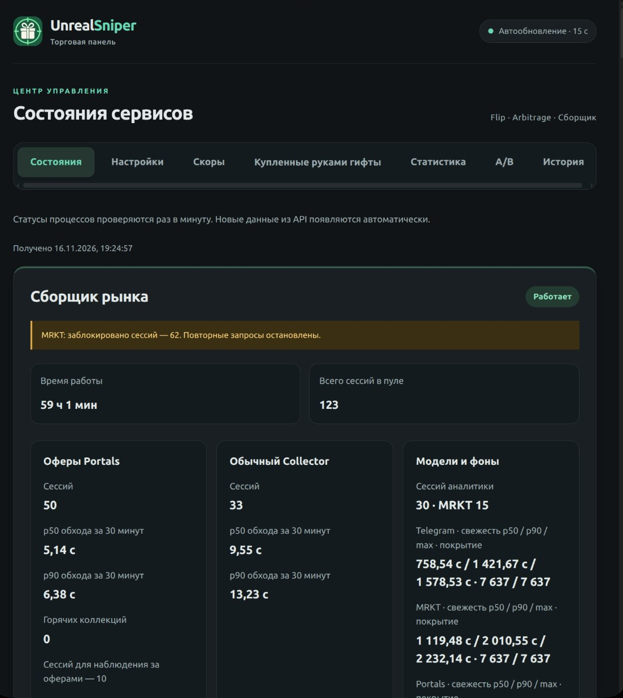
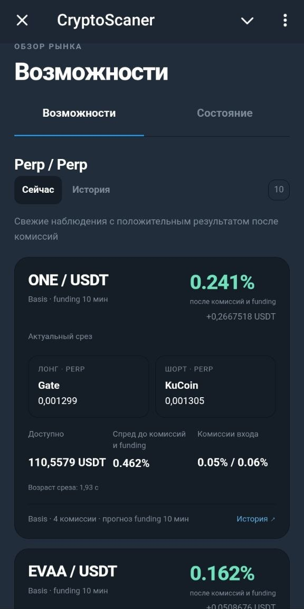

# MyPortfolio

**Бэкенд-разработка · C++ и Python · Рыночные данные · Торговая автоматизация**

Проекты, инженерные решения и примеры интерфейсов.

[Проекты](#проекты) · [Интерфейсы](#интерфейсы) · [Сертификаты](#сертификаты) · [Связаться](#контакты)

---

## Проекты

В описаниях — задачи, реализованная функциональность и ключевые решения. Для закрытых проектов опубликованы описания и доступные примеры интерфейсов.

### Основные системы

| Проект | Что реализовано | Основной стек |
| :--- | :--- | :--- |
| **01 · [UnrealSniper](projects/01-unreal-sniper.md)** Закрытый код | Сбор рыночных данных, торговые стратегии, межплощадочный арбитраж и управление сервисами через Telegram Mini App. | Python · asyncio · FastAPI · Redis · SQLite |
| **02 · [CryptoScaner](projects/02-crypto-scanner.md)** Закрытый код | Интеграции с биржами, единое состояние котировок, спотовые скринеры, история наблюдений и Telegram Mini App. | Python · WebSocket · PostgreSQL · CCXT |
| **03 · [Игровой сервер на C++](projects/03-cpp-game-backend.md)** [Открытый код](https://github.com/ST3PAN0V/backend_server) | HTTP API, игровая модель, сохранение состояния и таблица рекордов в PostgreSQL. Учебный проект по бэкенд-разработке. | C++20 · Boost.Asio · PostgreSQL · Docker |

### Прикладные сервисы

| Проект | Что реализовано | Основной стек |
| :--- | :--- | :--- |
| **04 · [Диалоговый ИИ-бот](projects/04-conversational-ai-bot.md)** Закрытый код | Контекст диалогов, квоты, оплата через Telegram Stars и согласованная обработка запросов внутри чата. | Python · httpx · SQLite · Telegram Bot API |
| **05 · [SnipeBot](projects/05-snipe-bot.md)** Закрытый код | Мониторинг предложений, проверка цены перед покупкой, уведомления и команды для диагностики. | Python · asyncio · Telethon · Click |
| **06 · [SummarySearchBot](projects/06-summary-search-bot.md)** Закрытый код | Сбор сообщений за выбранный период, обработка больших текстов и сводки со ссылками на источники. | Python · asyncio · Kurigram · OpenRouter |
| **07 · [Ассистент Workzilla](projects/07-workzilla-assistant.md)** [Открытый код](https://github.com/ST3PAN0V/workzilla_bot) | Получение заказов, классификация через YandexGPT, уведомления в Telegram и подготовка черновиков ответов. | Python · httpx · YandexGPT · Telegram Bot API |

### Небольшие проекты и практика

| Проект | Что реализовано | Основной стек |
| :--- | :--- | :--- |
| **08 · [Игры на C++](projects/08-cpp-games.md)** | Терминальная игра TerminalAdventure и ранняя графическая игра: игровая логика, управление, отрисовка и сборка. | C++ · ncurses · OpenGL · CMake |
| **09 · [Инструменты автоматизации](projects/09-automation-tools.md)** | Регистрация на мероприятия, пакетная обработка DOCX и формирование отчётов о рабочей нагрузке. | Python · SQLite · python-docx · C++17 |
| **10 · [Передача файлов по TCP и UDP](projects/10-tcp-udp-file-transfer.md)** [Открытый код](https://github.com/ST3PAN0V/file-transfer-udp-tcp) | Клиент и сервер для двух протоколов, работа с сокетами и проверка переданных файлов. | Python · socket · Bash |
| **11 · [Многопоточность в C++](projects/11-cpp-concurrency.md)** [Открытый код](https://github.com/ST3PAN0V/Multi_Threading_practice) | Асинхронные таймеры, несколько рабочих потоков и синхронизация общей коллекции результатов. | C++20 · Boost.Asio · CMake |

### Разборы и алгоритмы

| Материал | Содержание |
| :--- | :--- |
| **12 · [Latency Trap](projects/12-latency-trap.md)** | Разбор исторического инцидента на рынке Telegram-подарков: расхождение цены предложения и подтверждения платежа, выводы для проверки транзакций. |
| **13 · [Тренировки по алгоритмам](projects/13-algorithms.md)** | Решения Тренировок по алгоритмам 6.0 от Яндекса: **34 из 35 задач, 141-е место из 10 000+ участников**. |

## Интерфейсы

<table>
  <tr>
    <td align="center"><b>UnrealSniper</b> Мониторинг сервисов</td>
    <td align="center"><b>CryptoScaner</b> Ранний интерфейс</td>
  </tr>
  <tr>
    <td align="center"></td>
    <td align="center"></td>
  </tr>
</table>

Дополнительные скриншоты и пояснения — в описаниях проектов.

## Сертификаты

[Все сертификаты](Certificates/) · [Тренировки по алгоритмам от Яндекса](Certificates/YandexAlgorithmCertificate.pdf)

## Контакты

[GitHub](https://github.com/ST3PAN0V) · [Telegram](https://t.me/ArtemS101)
