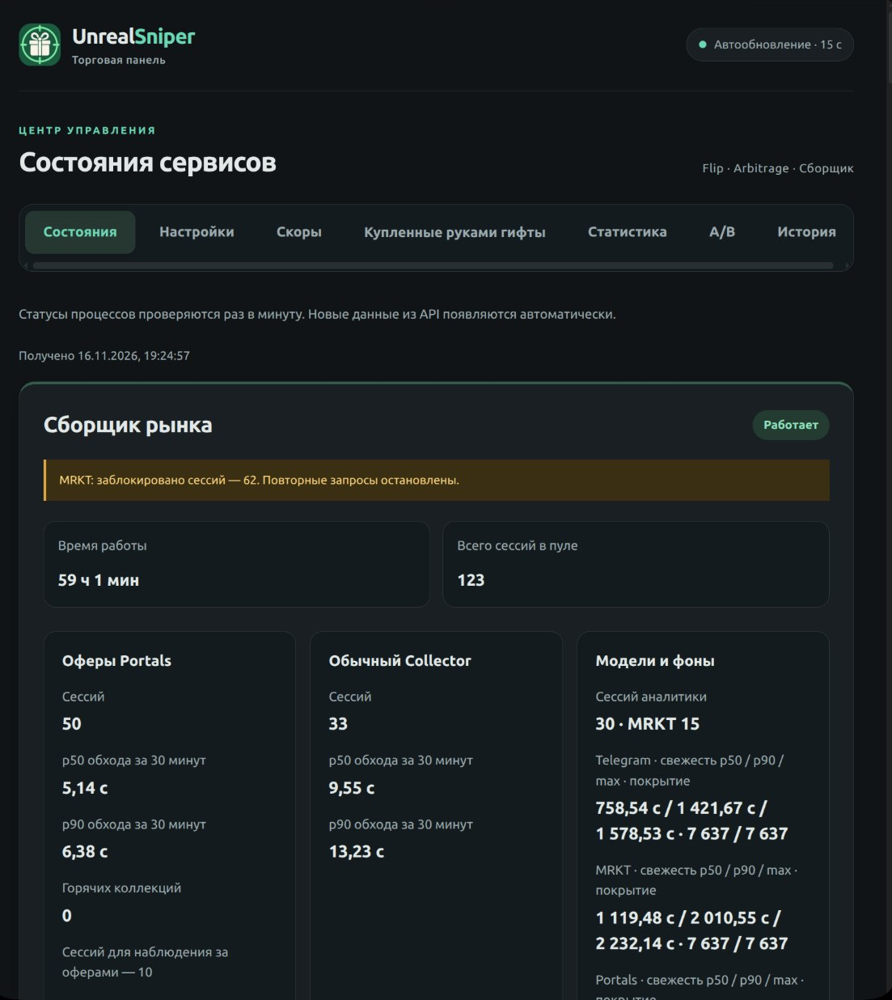
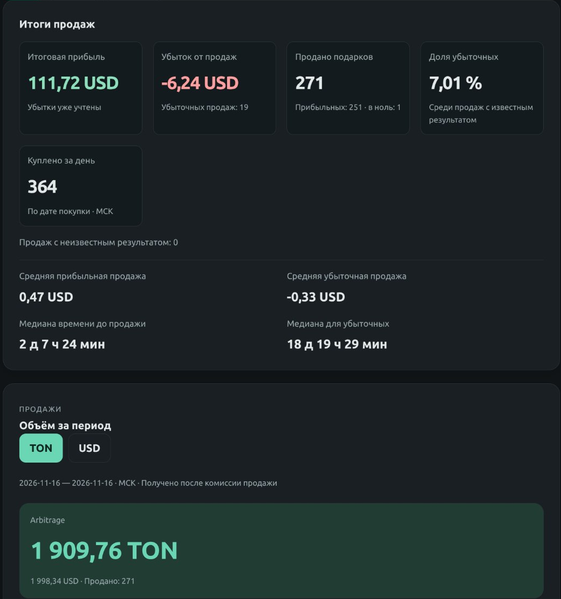
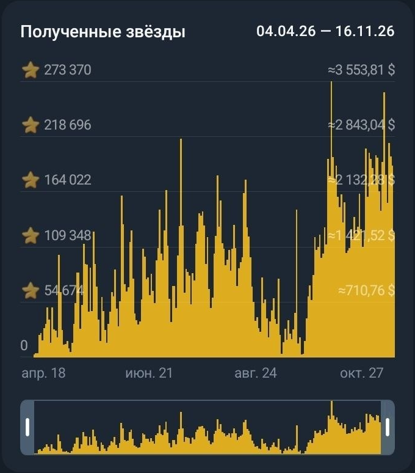

# UnrealSniper

Система торговли Telegram-подарками: сбор рынка, независимые стратегии, межплощадочный арбитраж и управление через Telegram Mini App.

**Стек:** Python · asyncio · FastAPI · Redis · SQLite  
**Исходный код:** закрытый

## Что реализовано

- Сборщик рыночных данных и общее состояние рынка в Redis.
- Отдельные сервисы торговых стратегий, использующие общие данные.
- API настроек, хранение конфигурации и истории операций.
- Mini App со статусами сервисов, настройками и торговой статистикой.

## Ключевые решения

Сбор рынка отделён от исполнения стратегий. Снимок данных и событие обновления публикуются атомарно; изменения настроек проходят проверку версии конфигурации. Мониторинг показывает состояние зависимостей и длительность операций, включая p95.

Компоненты проверяются тестами, проверкой типов и статическим анализом.

## Практическое применение

Оборот **всех Telegram-стратегий** за последние месяцы — **5 000–8 000 USD**, включая покупки и продажи. Данные на ноябрь 2026 года.

## Интерфейс

*Мониторинг сервисов в Telegram Mini App.*

Торговая статистика и активность в Stars

*Сводка операций за выбранный в интерфейсе период.*

*Активность за период, показанный на графике.*

---

[← Все проекты](../README.md)
