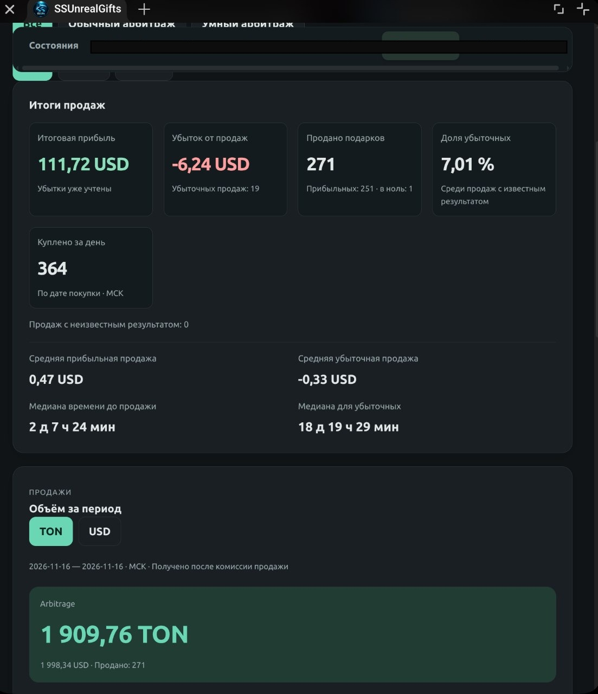
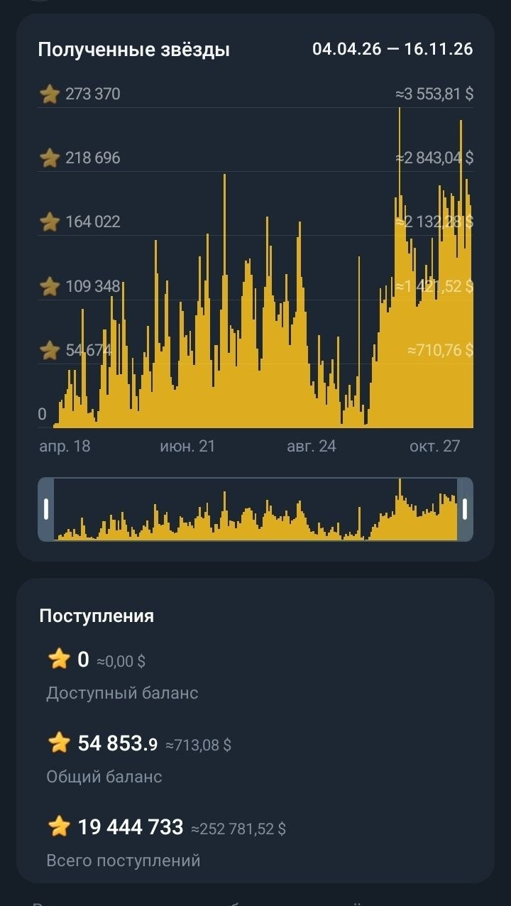
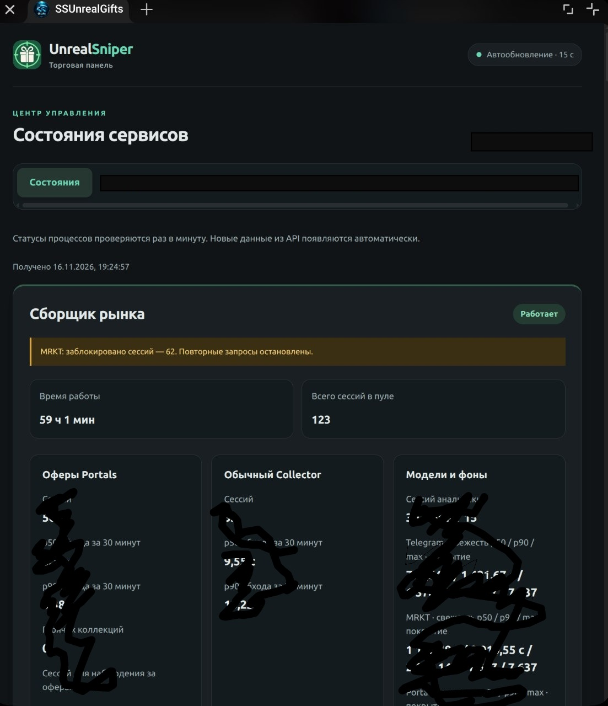

# 🎁 UnrealSniper

Система автоматической торговли NFT и Telegram-подарками: сбор рынка, арбитраж, снайпинг и высокочастотный флиппинг с управлением через Telegram Mini App.

**Разработка:** апрель–ноябрь 2026 года.  
**Стек:** Python · asyncio · aiohttp · FastAPI · Redis Pub/Sub и Streams · SQLite · JavaScript  
**Исходный код:** закрытый

## 📊 Результаты и торговая статистика

| Показатель | Значение |
| --- | --- |
| Обнаружение предложения → покупка | **8–10 мс в среднем**, включая ping |
| Совокупный оборот за 7 месяцев | **≈1,5 млн USD** |
| Суточный оборот всех стратегий | **≈7 000 USD** |
| Архитектура | **5 микросервисов** |
| Торговые стратегии | **3** |
| Интеграции | **6 API**, включая OKX |

Оборот — сумма покупок и продаж. Ниже — торговая статистика и история Stars из интерфейсов.

<b>📈 Торговая статистика в Mini App</b>

*Неполная статистика продаж за один день.*

<b>⭐ Активность, баланс и накопительные поступления Stars</b>

График относится к **одной стратегии** с оборотом около **2 000 USD в день**. Около **7 000 USD в день** — суммарный оборот **всех стратегий**.

💡 Для наглядности используется условная оценка: **1 ⭐ ≈ 1 ₽**.

*Полный скриншот: график за указанный в Telegram период и нижний блок баланса и накопительных поступлений.*

## 🛠 Что реализовано

- **Сбор и проверка данных.** Собственная ферма Telegram-аккаунтов с адаптивным RPS, интеграции с API площадок и общее состояние рынка в Redis для независимых торговых сервисов.
- **Три торговые стратегии.** Межплощадочный арбитраж, снайпинг и высокочастотный флиппинг; пул аккаунтов для выполнения операций.
- **Настройки и история.** FastAPI и SQLite обслуживают конфигурацию стратегий, её версии и историю операций.
- **Управление из Telegram.** Mini App объединяет настройки, состояния сервисов, торговую статистику, метрики и оповещения.
- **Наблюдаемость.** Мониторинг внешних зависимостей и длительности операций, включая средние, p95 и максимальные значения.

## ⚙️ Ключевые решения

Сбор данных отделён от исполнения стратегий. Снимок рынка и событие обновления публикуются атомарно, чтобы торговые сервисы работали с общим состоянием.

Для уменьшения задержки использованы извлечение нужных полей по смещениям, кэширование и размещение сервера ближе к площадке.

При изменении настроек проверяется версия конфигурации; управление проходит проверку авторизации. Для компонентов предусмотрены тесты, проверка типов и статический анализ. В одной системе доступны торговые сценарии, контроль их состояния и разбор результатов через Mini App.

## 🖥️ Панель управления

*Состояние сборщика и сервисов в Telegram Mini App.*

---

[← Все проекты](../README.md)
