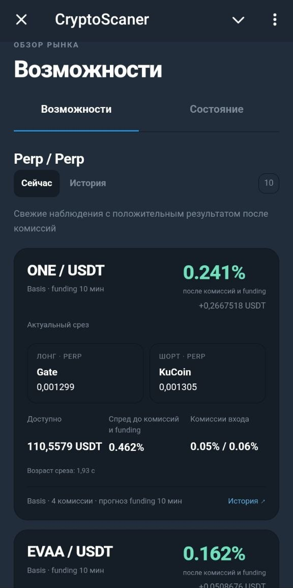

# CryptoScaner

Сервис сбора и анализа биржевых котировок: актуальное состояние рынка, история наблюдений и Telegram Mini App.

**Стек:** Python · asyncio · WebSocket · CCXT · PostgreSQL · asyncpg  
**Исходный код:** закрытый

## Что реализовано

- Биржевые адаптеры: получение и нормализация котировок, начальная синхронизация и восстановление соединений.
- Общее хранилище актуальных данных для нескольких сканеров.
- Межбиржевой и треугольный анализ спотового рынка.
- История наблюдений, событий и агрегатов в PostgreSQL; API для Mini App.

## Ключевые решения

При обработке котировок учитываются порядок обновлений и состояние источника. Состояние соединения отслеживается отдельно от времени последнего изменения цены. Аналитические компоненты используют общий поток данных.

Тесты проверяют порядок обновлений, идентификацию инструментов и состояние потоков.

## Ранний интерфейс

*На скриншоте — ранняя версия perp/perp. Текущая реализация, описанная выше, сосредоточена на спотовом рынке.*

---

[← Все проекты](../README.md)
