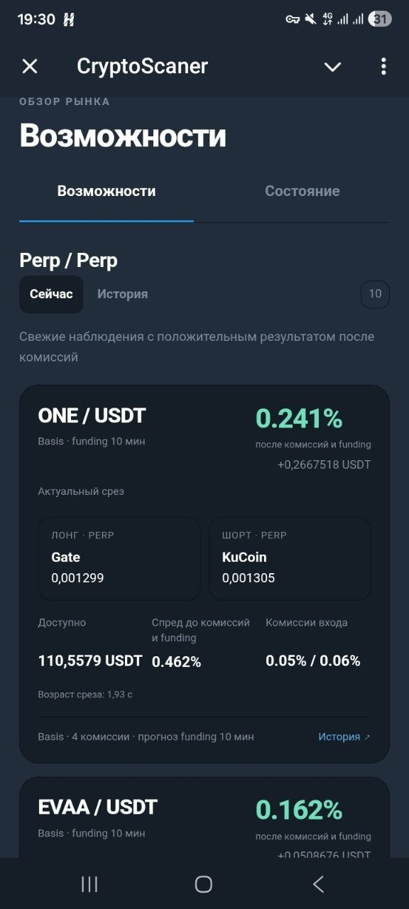

# CryptoScaner

### Market data collection, screening and monitoring

**Source code:** Private  
**Focus:** Exchange integrations · Asynchronous processing · Market data quality

CryptoScaner brings quotes from multiple exchanges into a shared asynchronous pipeline. It maintains current market state, runs spot-market screening, and stores events and aggregates for review in a Telegram Mini App.

## Problem

Quotes from different exchanges arrive through separate APIs, use different instrument identifiers, and can become unreliable when a connection fails. A useful scanner needs a consistent view of the market and enough history to explain how an observation changed over time.

## Implementation

- Exchange adapters collect streaming quotes and support initial synchronization and recovery.
- A shared in-memory quote book tracks the latest accepted prices and the health of each data stream.
- Cross-exchange and triangular spot screeners consume the same market state.
- PostgreSQL stores current observations, event history and aggregated time series.
- A separate dashboard backend serves the Telegram Mini App with authenticated access.

## Architecture

| Layer | Responsibility |
| --- | --- |
| Exchange adapters | Collect and normalize market data from external APIs. |
| Quote book and screeners | Maintain current state and evaluate spot-market observations. |
| PostgreSQL | Preserve event lifecycles and aggregates for later review. |
| Dashboard API and Mini App | Present current observations and historical views. |

## Engineering focus

- Preventing older updates from replacing newer market state.
- Distinguishing connection health from the age of the last price change.
- Sharing one quote pipeline across multiple analytical components.
- Testing quote ordering, instrument identity and stream confirmation.

## Product snapshot

*An earlier interface for perpetual-versus-perpetual monitoring. This screenshot shows an earlier version; the current implementation described in this case study focuses on spot-market collection and screening.*

## Stack

**Python · asyncio · aiohttp · asyncpg · PostgreSQL · CCXT · WebSocket**

Development tooling includes pytest, pytest-asyncio and Ruff.

[← Back to portfolio](../../README.md)
