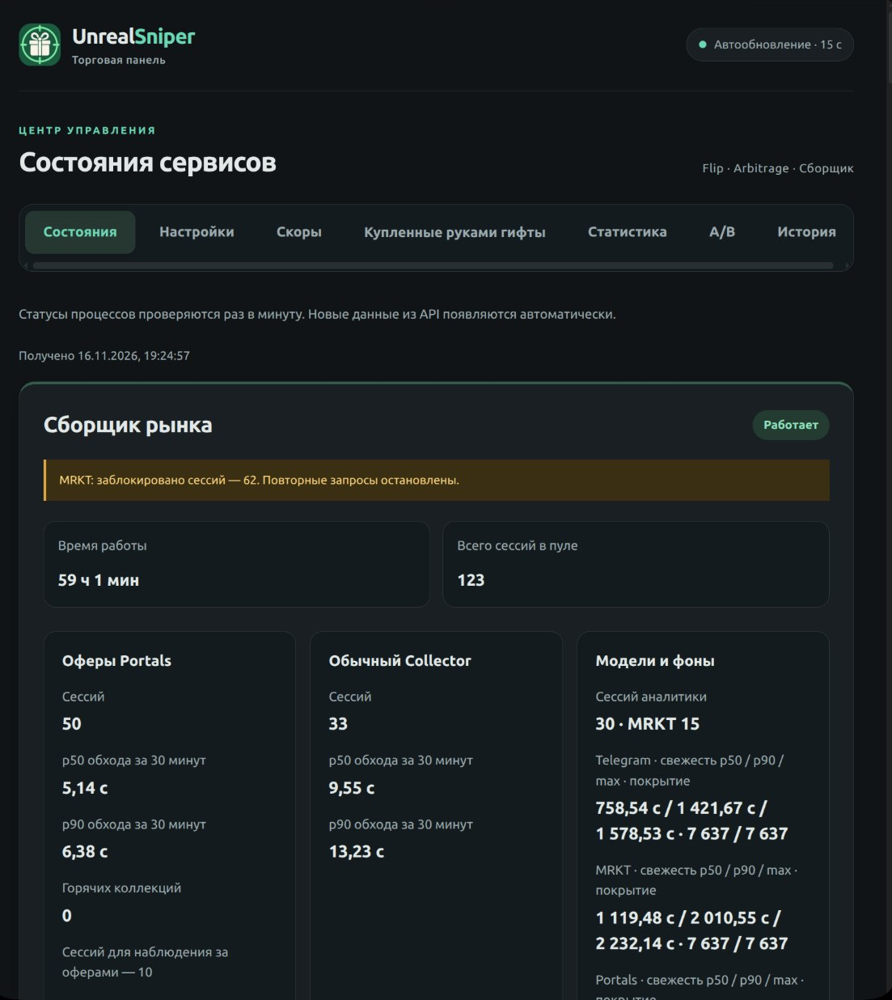
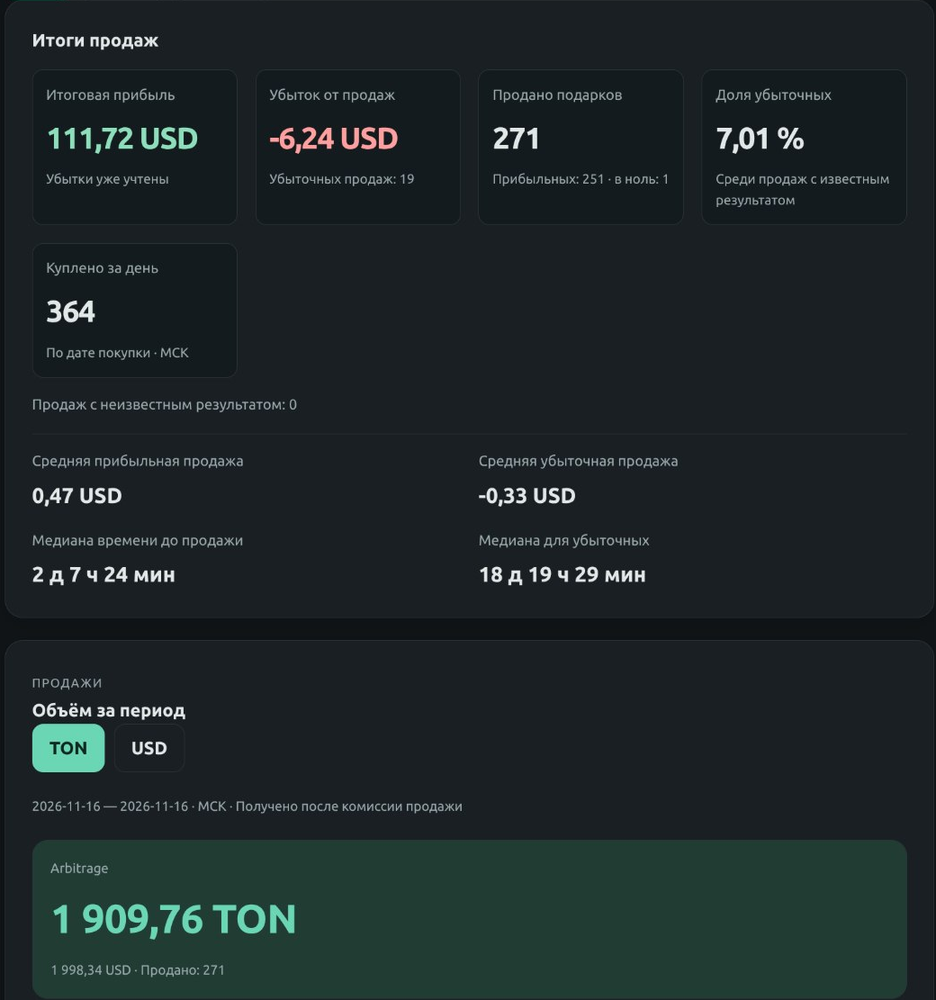
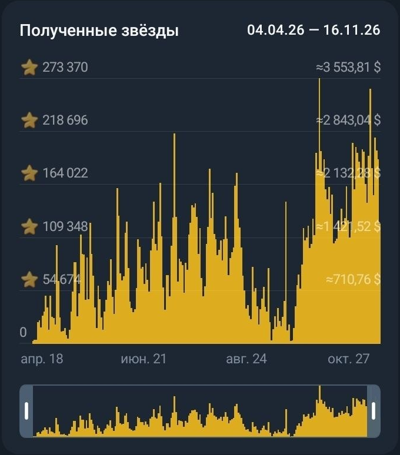

# UnrealSniper

### Telegram marketplace automation

**Source code:** Private  
**Focus:** Service architecture · Trading automation · Operational tooling

UnrealSniper combines market data collection, automated Telegram gift trading workflows and a Telegram Mini App. Separate services handle data collection, same-market strategies, cross-market arbitrage and centralized configuration.

## Problem

Several automated workflows need a consistent view of prices and operational state. Collection, trading actions and interface requests also need to remain manageable when an external API slows down or a service reconnects.

## Implementation

- A dedicated collector gathers market information and publishes shared snapshots through Redis.
- Independent strategy services consume that shared data and maintain their own operational state.
- A FastAPI service manages configuration, state and history in SQLite.
- A Telegram Mini App provides service monitoring, settings and activity views.
- Timing instrumentation records task durations, including average, p95 and maximum values.

## Architecture

| Component | Responsibility |
| --- | --- |
| Collector | Read market data and publish snapshots and update events. |
| Redis | Distribute shared market state to the working services. |
| Strategy services | Run trading workflows and report operational state. |
| Configuration API and SQLite | Manage settings, revisions, state and history. |
| Mini App gateway and interface | Provide authenticated access to monitoring and controls. |

## Engineering focus

- Publishing a market snapshot and its update notification atomically.
- Keeping data collection separate from strategy execution.
- Checking configuration revisions when settings change.
- Handling unavailable dependencies and exposing service health.
- Supporting component tests, type checks and static analysis.

## Telegram strategy activity

| Measure | Reported value |
| --- | --- |
| Approximate combined turnover | **US$5,000–8,000** |
| Scope | All Telegram trading strategies |
| Calculation | Purchase amounts + sale amounts |
| Reporting period | Recent months, as reported in November 2026 |

## Product snapshots

### Service status

*Collector and strategy service monitoring in the Telegram Mini App.*

### Trading statistics

*An operational statistics view for the Telegram trading workflows.*

### Stars activity

*Telegram Stars activity over the reporting window shown in the interface.*

## Stack

**Python · asyncio · FastAPI · Pydantic · Redis · SQLite · aiohttp · Kurigram/Pyrogram · JavaScript**

Development tooling includes pytest, Ruff, mypy, ESLint and Prettier.

[← Back to portfolio](../../README.md)
